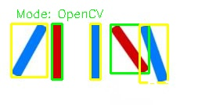
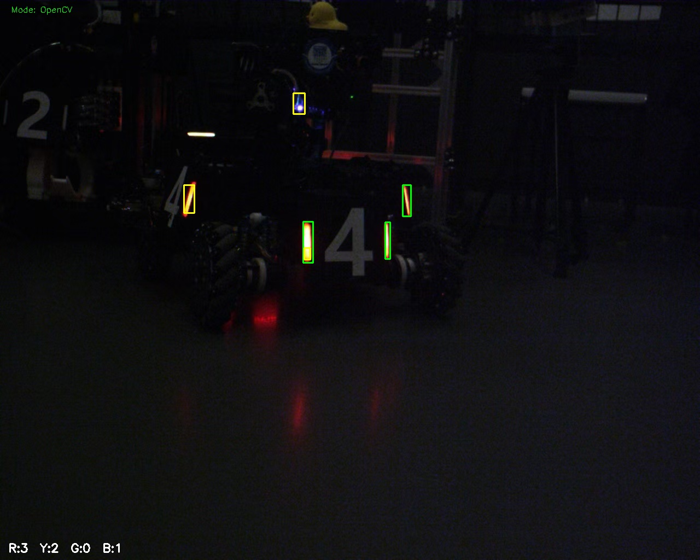

# 视觉第一次作业 —— 图像目标检测

## 一、使用方式

```bash
# 任务一：颜色区域框选（白底红蓝竖条）
./vision_app rm1.jpg

# 任务二：装甲板灯条框选（暗光实拍）
./vision_app test.jpg
./vision_app armor.jpg
```

不带参数时默认处理 `test.jpg`。

窗口打开后的按键：

| 按键 | 作用 |
| --- | --- |
| `s` | 保存当前结果图，文件名形如 `result_opencv_test.jpg`（不同原图不会互相覆盖；同一张图重复保存会自动加序号 `_1`、`_2`） |
| `q` / `ESC` | 退出 |

## 二、结果

**任务一（rm1.jpg）** —— 黄框 = 蓝色区域，绿框 = 红色区域：



**任务二（test.jpg，暗光实拍）** —— 灯条框选（车身、地面的红光反光未误检）：



## 三、目录结构

```
.
├── CMakeLists.txt              # 构建脚本
├── include/
│   └── TrafficLightDetector.h  # OpenCV 传统视觉检测器
├── src/
│   ├── main.cpp                # 主程序：读取图片并检测、保存结果
│   └── TrafficLightDetector.cpp
├── test.jpg / armor.jpg         # 任务二测试图（暗光实拍整车）
├── rm1.jpg                      # 任务一测试图（白底红蓝竖条）
├── result_opencv_test.jpg       # 任务二结果图
└── result_opencv_rm1.jpg        # 任务一结果图
```
